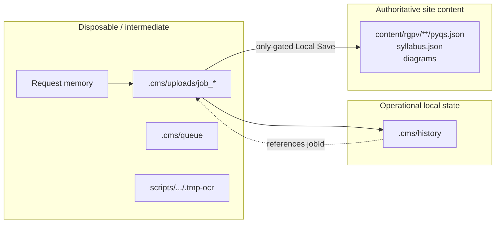

# Data and Recovery

**Audit date:** 2026-10-10  
**Related:** [SYSTEM_ARCHITECTURE.md](./SYSTEM_ARCHITECTURE.md) · [END_TO_END_WORKFLOW.md](./END_TO_END_WORKFLOW.md) · [FAILURE_ANALYSIS.md](./FAILURE_ANALYSIS.md)

## 1. Persistence model overview



`.cms/` is listed in `.gitignore` — local machine state is **not** the Git source of truth.

## 2. Authoritative content boundary

| Path                                                     | Role                                       |
| -------------------------------------------------------- | ------------------------------------------ |
| `content/rgpv/<branch>/semester-<n>/<subject>/pyqs.json` | Published PYQ papers for the subject       |
| `…/syllabus.json`                                        | Syllabus                                   |
| Subject diagram folders under content                    | Attachments after successful diagram write |

**AL-405 snapshot at audit:** `content/rgpv/aiml/semester-4/al-405/pyqs.json` contains **6** papers (2022–2025). No June 2026 paper was present. Syllabus file exists separately.

Writes require:

1. Local CMS mode
2. `CMS_ALLOW_CONTENT_WRITE=true`
3. Passing eligibility + extraction quality `canSave` (+ duplicate confirmation when required)
4. Explicit save API after approval

## 3. Job workspace layout

Created by `temp-storage.ts` / upload:

```text
.cms/uploads/<jobId>/
  original.<ext> | originals/
  metadata.json
  pipeline.json
  raw-document.json
  structured-document.json
  academic-document.json
  extraction-evidence.json
  production-pyqs.json
  production-syllabus.json   # may be absent for PYQ-only
  pending-pyqs.json
  pending-syllabus.json      # should stay unused/null path for PYQ-only
  validation-report.json
  write-report.json
  save-report.json
  review-state.json
  import-diagnostics.json
  diagram-manifest.json      # may be absent
  diagrams/ pages/ images/ tables/ logs/ checkpoints/
```

Filenames centralized in `constants.ts`.

## 4. Queue and history

| Store                       | Contents                                                               |
| --------------------------- | ---------------------------------------------------------------------- |
| `.cms/queue/queue.json`     | Job references / queue index                                           |
| `.cms/history/index.json`   | History index                                                          |
| `.cms/history/<jobId>.json` | Per-import summary (`questionsImported`, status, timings, warnings, …) |

History rows for the same PDF are **independent**. Example AL-405 `questionsImported` values observed: 4, 6, 8, 10.

## 5. Extracted preview vs merged save candidate

`review-service.getReviewPackage` distinguishes:

| Field                                 | Meaning                                               |
| ------------------------------------- | ----------------------------------------------------- |
| `extractedPyqs` / `productionPyqs`    | One-paper extraction preview (`production-pyqs.json`) |
| `mergedSaveCandidate` / `pendingPyqs` | Existing authoritative papers + incoming (merge)      |
| `existingPyqs`                        | Current `content/…/pyqs.json` read-only baseline      |

UI must not present merged history as “newly extracted.” Code comments and review-data-integrity tests encode this invariant; **UI correctness for every screen: PARTIALLY VERIFIED**.

## 6. Checkpointing and resume

- `stage-checkpoint.ts`: begin / heartbeat / finish per supervised stage
- Supervisor skips completed stages when resumable
- Eligibility skip uses persisted eligibility artifact

**Limitation:** Completeness of a checkpoint does not prove the artifact matches the **current code version**. Resuming old jobs after large uncommitted changes is risky.

## 7. Duplicate handling

- `duplicate-paper-detector.ts` classifies exact/possible duplicates against existing content
- Save path can require `confirmDuplicateSave`
- Re-uploading the same file still creates a **new** job + history entry

## 8. Recovery APIs / services

Present in tree:

- `app/api/cms/recovery`
- `app/api/cms/rebuild`
- `job-recovery` / failure-handler patterns (see reliability audit)
- `history-delete-service.ts` (delete history entries — **dangerous if misused**)

Exact recovery success rates: **NOT VERIFIED** in this audit. Inspect debug endpoint `GET /api/cms/debug/pipeline/[jobId]` before trusting resume.

## 9. Temporary / probe artifacts

| Location                            | Role                                                    |
| ----------------------------------- | ------------------------------------------------------- |
| `scripts/cms-reliability/.tmp-ocr/` | Golden/live OCR dumps, suite logs, acceptance summaries |
| Job `pages/` / `images/`            | Rasterized page WebPs/PNGs                              |

These are **not** authoritative public content.

## 10. Git publishing

- CMS Git API: read-only snapshot (`git-review.ts`)
- POST mutations blocked
- Maintainer must run `git add/commit/push` manually outside CMS

Working tree at audit already contains many modified/untracked pipeline files **plus** this documentation when created — capture `git status` before any commit decisions.

## 11. Syllabus isolation (PYQ-only)

Intended: PYQ import keeps `incomingSyllabus` null; syllabus diff empty; no `syllabus.json` write.

Supported by merge helpers + `review-data-integrity` tests. Live confirmation that no AL-405 job wrote syllabus: **PARTIALLY VERIFIED** (authoritative syllabus hash was stable in a prior integrity probe; not re-hashed in this audit session).

## 12. Safe inspection without mutation

```bash
# Examples — read-only
ls .cms/history | head
python -c "import json;print(json.load(open('.cms/history/<jobId>.json'))['questionsImported'])"
# Compare production preview
# open .cms/uploads/<jobId>/production-pyqs.json
# open .cms/uploads/<jobId>/raw-document.json  # real pageCount
```

Avoid: save API, history delete, `CMS_ALLOW_CONTENT_WRITE`, deleting job folders that still have history pointers you need.
