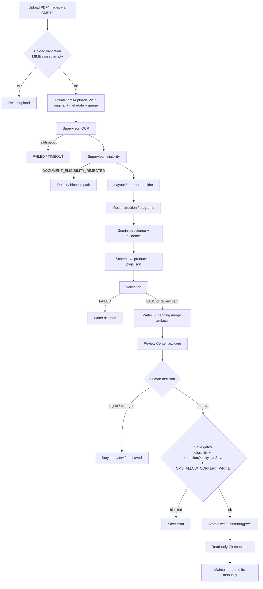
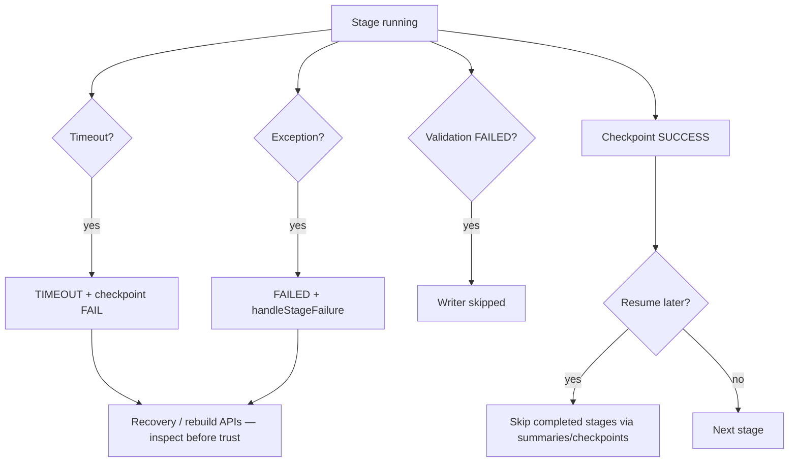

# End-to-End Workflow

**Audit date:** 2026-10-10  
**Related:** [SYSTEM_ARCHITECTURE.md](./SYSTEM_ARCHITECTURE.md) · [DATA_AND_RECOVERY.md](./DATA_AND_RECOVERY.md) · [FAILURE_ANALYSIS.md](./FAILURE_ANALYSIS.md)

## 1. End-to-end processing flow

## 2. Stage detail

For each stage: entry points, I/O, validation, failures, side effects, verification posture.

### 2.1 CMS entry and upload validation

| Field | Detail |
|---|---|
| Entry | `app/api/cms/upload/route.ts` → `upload-service.processUpload` / bulk path |
| UI | `components/admin/content-upload.tsx`, `cms-import-panel.tsx` (untracked) |
| Input | `File`, job type, branch/semester/subject hints |
| Output | `ImportJobRecord`; `.cms/uploads/<jobId>/original.*`, `metadata.json`, `pipeline.json`; queue entry |
| Validation | `validateUploadConstraints`, `isSupportedMimeType` (PDF/PNG/JPG/JPEG/WEBP/TIFF), empty-file reject |
| Limits | Enforced later/also via `import-limits.ts`: PDF ≤5 pages, images ≤5, one paper; merged multi-paper mode rejected |
| Side effects | Creates job directory (never overwrite existing id) |
| Status | **IMPLEMENTED, PARTIALLY VERIFIED** (code inspected; live upload not re-run) |

### 2.2 OCR / PDF ingestion

| Field | Detail |
|---|---|
| Entry | Supervisor `ocr` → `ocr-service.runOcrForJob` → `LocalOcrEngine.extract` |
| Dependencies | pdfjs-dist, tesseract.js, sharp, canvas |
| Output | `raw-document.json` (+ page images under job `pages/` / `images/`) |
| Evidence | Page dimensions, text blocks, bboxes, per-block confidence when OCR provides them |
| Failures | Stage timeout (420s), sticky PROCESSING recovery patterns (see reliability audit) |
| Side effects | Large job artifacts under `.cms/uploads` |
| Known limits | Scanned bilingual landscape papers are hard; OCR text quality varies; preprocess/column OCR paths exist in current tree |
| Status | **IMPLEMENTED BUT UNRELIABLE** for real RGPV scans |

### 2.3 Eligibility

| Field | Detail |
|---|---|
| Entry | Supervisor `eligibility` → `document-eligibility-service` |
| Output | Eligibility artifact; reject stops pipeline with `DocumentEligibilityError` |
| Rules | RGPV / question-paper heuristics (`document-eligibility.ts`) |
| Status | **IMPLEMENTED, PARTIALLY VERIFIED** (unit tests exist; live reject paths not re-run here) |

### 2.4 Layout, reading order, question detection

| Field | Detail |
|---|---|
| Entry | `layout` → layout service → `structure-builder.buildStructuredDocument` |
| Components | `block-detector`, `reading-order` (column bands when ≥8 blocks), `question-detector`, `question-number`, `header-footer`, `question-continuation` |
| Output | `structured-document.json` |
| Limits | Column detection heuristics; cross-column body attachment bugs historically broke AL-405 Q.5(b); OCR marker packing requires splitting |
| Status | **IMPLEMENTED BUT UNRELIABLE** |

### 2.5 Diagram / reconstruction

| Field | Detail |
|---|---|
| Entry | Supervisor `reconstruction` → `diagram-service.runDiagramsForJob` |
| Geometry path | `diagram-extractor` / `diagram-metadata` — comment states **no AI captions** |
| AI path | `diagram-ai-context.ts` + Gemini prompts **do** fill title/alt/caption/aiContext |
| Observed | AL-405 jobs attach page WebPs as diagrams with Gemini captions (verified in artifacts) |
| Status | **IMPLEMENTED BUT UNRELIABLE** / semantically unsafe for attachments |

### 2.6 Evidence + Gemini normalization

| Field | Detail |
|---|---|
| Evidence | `extraction-evidence.buildExtractionEvidence` → candidates, tokens, tables, warnings |
| Structuring | `structuring-service` + `GeminiStructuringEngine` (`gemini-2.5-flash-lite` default) |
| Prompt | `prompt-builder.ts` — forbids inventing/paraphrasing; English-only preference |
| Validation | `evidence-validator.validateAgainstEvidence` (numbers, Hindi leftovers, invented text heuristics) |
| Output | `academic-document.json` |
| Limits | Model can still invent captions/diagram semantics; evidence grounding is incomplete; fallbacks may hardcode confidence |
| Status | **IMPLEMENTED BUT UNRELIABLE** |

### 2.7 Schema, validation, writer

| Field | Detail |
|---|---|
| Schema | `schema-builder-service` → `production-pyqs.json` / syllabus preview |
| Validation | `validation-service` → `validation-report.json` |
| Writer | `writer-service` → `pending-pyqs.json` merge candidate, write report |
| Important | Schema **PASS ≠ correct extraction** |
| Status | **IMPLEMENTED, PARTIALLY VERIFIED** |

### 2.8 Review package

| Field | Detail |
|---|---|
| Entry | `review-service.getReviewPackage` / `startReviewForJob` |
| Separates | `extractedPyqs` (one-paper preview) vs `mergedSaveCandidate` / `pendingPyqs` |
| Gates surfaced | `extractionQuality` (`READY` / `NEEDS_REVIEW` / `BLOCKED`), `qualityIndicators`, eligibility, duplicates |
| UI | `review-center.tsx`, `approval-panel.tsx` |
| Confirmed UI bugs | Page count from missing `evidenceFile.pages`; OCR % from default `0.5`; `Q` + `Q.1` → `QQ.1` display |
| Status | **IMPLEMENTED, PARTIALLY VERIFIED** with confirmed indicator defects |

### 2.9 Approve and local save

| Field | Detail |
|---|---|
| Save | `local-save-service.runLocalSaveForJob` |
| Gates | `CMS_ALLOW_CONTENT_WRITE`, eligibility, `assessExtractionQuality.canSave`, duplicate confirmation |
| Write | Atomic JSON write into subject content dir; diagram copy paths |
| Git | Review can fetch read-only snapshot; **no auto commit/push** |
| Status | **IMPLEMENTED, PARTIALLY VERIFIED** (gates in code; save not exercised in this audit) |

## 3. Intermediate artifacts (per job)

Typical under `.cms/uploads/<jobId>/`:

| Artifact | Role |
|---|---|
| `original.*` / `originals/` | Source bytes |
| `metadata.json`, `pipeline.json` | Job identity / stage |
| `raw-document.json` | OCR/native extract |
| `structured-document.json` | Layout graph |
| `diagrams/`, diagram assets | Cropped/page images |
| `extraction-evidence.json` | Candidates + warnings |
| `academic-document.json` | Normalized academic model |
| `production-pyqs.json` | Extracted one-paper preview |
| `pending-pyqs.json` | Merged save candidate |
| `validation-report.json`, `write-report.json`, `save-report.json` | Stage reports |
| `review-state.json` | Human decision |
| `checkpoints/` | Supervisor checkpoints |
| `import-diagnostics.json` | Aggregated timings / pageCount |
| `logs/` | Stage logs |

Authoritative after save only: `content/rgpv/<branch>/semester-N/<subject>/pyqs.json` (+ diagrams under content if written).

## 4. Failure and recovery flow

Verified behaviors:

- Supervisor skips completed stages when `resumable` and summaries/eligibility artifacts exist.
- Sticky `*_PROCESSING` recovery was a prior reliability focus (`docs/CMS_PIPELINE_RELIABILITY_AUDIT.md`).
- Duplicate imports create **new job IDs** and history rows — they do not automatically collapse.

## 5. Persistence vs memory

| Phase | Memory | Disk |
|---|---|---|
| Upload request | File buffer | Job dir + queue |
| OCR/layout | Page/worker state | raw/structured JSON + images |
| Gemini | Prompt/response | academic-document.json |
| Review GET | Assembled `ReviewPackage` | Reads existing job files; may write diagnostics/review-state |
| Save | Merge buffers | Authoritative content JSON (if enabled) |

## 6. Verification posture for this document

| Claim | Status |
|---|---|
| Stage sequence and timeouts | Verified in source |
| Artifact filenames | Verified in `constants.ts` + job dirs |
| Live end-to-end timing on this machine today | **NOT VERIFIED** (no import run) |
| Every UI button wiring | **PARTIALLY VERIFIED** |
