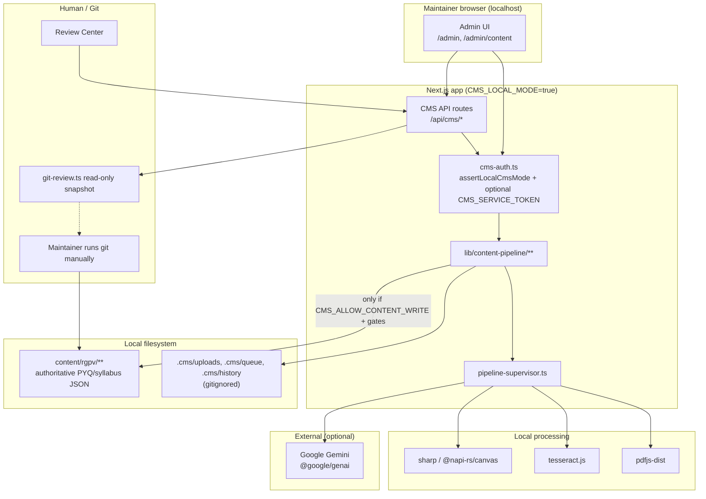

# System Architecture

**Audit date:** 2026-10-10 · Branch: `main`  
**Related:** [END_TO_END_WORKFLOW.md](./END_TO_END_WORKFLOW.md) · [DATA_AND_RECOVERY.md](./DATA_AND_RECOVERY.md) · [AUDIT_EVIDENCE.md](./AUDIT_EVIDENCE.md)

## 1. Purpose

HyperLearningTech is a Next.js academic content site. The **CMS** is a **local-only authoring tool** that imports RGPV question papers into subject folders under `content/rgpv/**`. Production/Vercel deployments are intended to remain **read-only** for CMS write APIs.

## 2. High-level architecture (verified)



**Uncertain edges:** Clerk is used for the public app; local CMS does **not** require Clerk (`lib/cms-auth.ts`). Prisma/Redis appear in dependencies for the wider product; CMS import persistence inspected here is **filesystem-based** under `.cms/`. Database involvement in CMS jobs: **NOT VERIFIED** as primary storage for import jobs.

## 3. Runtime and scripts

From `package.json`:

| Script                         | Role                                                         |
| ------------------------------ | ------------------------------------------------------------ |
| `npm run cms`                  | `CMS_LOCAL_MODE=true next dev -H 127.0.0.1 -p 3000`          |
| `npm run test` / `cms:verify`  | `tsx --test` over listed `scripts/cms-reliability/*.test.ts` |
| `cms:sharp`                    | Sharp smoke (`scripts/cms-reliability/verify-sharp.ts`)      |
| `cms:report`                   | Report generator                                             |
| `typecheck` / `lint` / `build` | Standard Next/TS checks                                      |

Stack highlights: Next 16, React 19, `pdfjs-dist`, `tesseract.js`, `sharp`, `@napi-rs/canvas`, `@google/genai`, Clerk (public), Zod.

## 4. Application structure

### Admin UI

| Path                                    | Role                                               |
| --------------------------------------- | -------------------------------------------------- |
| `app/admin/layout.tsx`                  | CMS layout / page access guard                     |
| `app/admin/page.tsx`                    | Admin home                                         |
| `app/admin/content/page.tsx`            | Content / import surface                           |
| `components/admin/content-upload.tsx`   | Upload UI                                          |
| `components/admin/review-center.tsx`    | Review orchestration                               |
| `components/admin/approval-panel.tsx`   | Quality indicators, evidence mapping, approve/save |
| `components/admin/import-history*.tsx`  | History list/filters                               |
| `components/admin/cms-import-panel.tsx` | Untracked (working tree) import panel              |

### CMS API routes (`app/api/cms/`)

| Route                                                                       | Typical purpose                                |
| --------------------------------------------------------------------------- | ---------------------------------------------- |
| `upload`, `bulk`                                                            | Accept files → create job dirs                 |
| `queue`                                                                     | Queue listing / control                        |
| `ocr`, `layout`, `diagrams`, `structuring`, `schema`, `validation`, `write` | Stage triggers / status                        |
| `review`, `save`                                                            | Human review + local save                      |
| `history`                                                                   | Import history                                 |
| `git`                                                                       | Read-only Git snapshot; POST mutations blocked |
| `recovery`, `rebuild`                                                       | Recovery / rebuild paths                       |
| `debug/pipeline/[jobId]`                                                    | Supervisor debug                               |

Handlers wrap `requireCmsAuth` / `withCmsAuth` (see `lib/content-pipeline/cms-route-auth.ts`, `lib/cms-auth.ts`).

## 5. Content-pipeline module inventory

Core orchestration:

| Module                                                                                       | Actual role (verified by source)                      |
| -------------------------------------------------------------------------------------------- | ----------------------------------------------------- |
| `pipeline-supervisor.ts`                                                                     | Owns stage order, timeouts, checkpoints, resume skips |
| `stage-runtime.ts`                                                                           | Per-stage timeout budgets                             |
| `stage-checkpoint.ts`                                                                        | Checkpoint begin/heartbeat/finish                     |
| `import-session-service.ts`                                                                  | Session processing / pipeline start                   |
| `pipeline-scheduler.ts`                                                                      | Schedules `ensureImportSessionPipeline`               |
| `upload-service.ts`                                                                          | MIME/size validation, job dir creation, enqueue       |
| `import-limits.ts`                                                                           | ≤5 PDF pages, ≤5 images, one paper per import         |
| `ocr-service.ts` + `local-ocr-engine.ts`                                                     | PDF/image → `raw-document.json`                       |
| `ocr-preprocess.ts`                                                                          | Image preprocess helpers (sharp)                      |
| `layout-service.ts` + `structure-builder.ts`                                                 | Layout / structured document                          |
| `block-detector.ts`, `reading-order.ts`, `question-detector.ts`, `question-number.ts`        | Classification, order, grouping, markers              |
| `paper-segmenter.ts`, `question-continuation.ts`, `header-footer.ts`                         | Paper bounds, cross-page, chrome                      |
| `diagram-service.ts`, `diagram-extractor.ts`, `diagram-metadata.ts`, `diagram-ai-context.ts` | Crop/manifest + optional Gemini caption enrichment    |
| `extraction-evidence.ts`                                                                     | Evidence package for normalization / fallbacks        |
| `structuring-service.ts`, `gemini-structuring.ts`, `prompt-builder.ts`                       | Gemini normalization                                  |
| `evidence-validator.ts`                                                                      | AI vs evidence checks                                 |
| `schema-builder-service.ts`, `pyq-schema-builder.ts`                                         | Production JSON preview                               |
| `validation-service.ts`, `validation-engine.ts`, `validation-rules.ts`                       | Schema / rule validation                              |
| `document-eligibility.ts` (+ service)                                                        | RGPV / question-paper gate                            |
| `duplicate-paper-detector.ts`                                                                | Duplicate classification                              |
| `extraction-quality.ts`, `content-quality-indicators.ts`, `warning-catalog.ts`               | Readiness / UI indicators                             |
| `writer-service.ts`, `local-save-service.ts`                                                 | Pending merge + optional authoritative write          |
| `merge-service.ts`, `diff-service.ts`                                                        | Merge / diff                                          |
| `review-service.ts`, `review-types.ts`                                                       | Review package assembly                               |
| `history-service.ts`, `history-delete-service.ts`                                            | History records                                       |
| `git-review.ts`                                                                              | Read-only Git                                         |
| `import-diagnostics.ts`                                                                      | Aggregated timings / pageCount for operators          |
| `english-text.ts`                                                                            | English vs Devanagari filtering helpers               |

Constants and filenames: `lib/content-pipeline/constants.ts` (`CMS_UPLOADS_DIR = ".cms/uploads"`, production/pending JSON names, etc.).

## 6. Supervised stage sequence

Verified in `pipeline-supervisor.ts`:

```text
ocr → eligibility → layout → reconstruction → structuring → schema → validation → writer
```

Timeouts (`stage-runtime.ts`): OCR 420s, eligibility 30s, layout/reconstruction 60s, structuring 240s, schema/validation 60s, writer 120s, review 30s (auto).

Older docs (`docs/CMS_PIPELINE_RELIABILITY_AUDIT.md`) omit the **eligibility** stage — treat that file as historical relative to current `STAGE_SEQUENCE`.

## 7. Data boundaries

| Store                                        | Authoritative?               | Tracked in Git?   | Notes                                              |
| -------------------------------------------- | ---------------------------- | ----------------- | -------------------------------------------------- |
| `content/rgpv/**/pyqs.json`, `syllabus.json` | **Yes** (public site source) | Yes               | Must not be mutated by casual imports              |
| `.cms/uploads/<jobId>/**`                    | No — working artifacts       | No (`.gitignore`) | OCR, evidence, production preview, checkpoints     |
| `.cms/queue/queue.json`                      | No                           | No                | Job references                                     |
| `.cms/history/**`                            | Operational history          | No                | Import history entries                             |
| `scripts/cms-reliability/.tmp-ocr/**`        | No — test/probe scratch      | Untracked locally | Probe/golden OCR dumps                             |
| Gemini API                                   | External                     | N/A               | Normalization / diagram captions when keys present |
| In-memory                                    | Transient                    | N/A               | Supervisor loop, request handlers                  |

## 8. Authentication and security boundaries

Verified in `lib/cms-auth.ts`:

1. **`isLocalCmsMode()`** — requires `CMS_LOCAL_MODE=true` and **not** Vercel production/preview (`VERCEL_ENV` / `VERCEL=1`).
2. **`assertLocalCmsMode()` / `requireCmsAuth()`** — fail closed outside local mode (404-style CMS_LOCAL_ONLY).
3. Local browser access becomes **`local-admin` ADMIN** without Clerk.
4. Optional **`CMS_SERVICE_TOKEN`** Bearer for automation; wrong token → 401 (no silent fallback).
5. **`CMS_ALLOW_CONTENT_WRITE`** — separate gate for writing under `content/` (`local-save-service.ts` + `isCmsContentWriteEnabled()`).
6. Git API POST → **405 GIT_MUTATION_BLOCKED**.

Env names (from `.env.example`, values not audited): `CMS_LOCAL_MODE`, `CMS_ALLOW_CONTENT_WRITE`, `CMS_SERVICE_TOKEN`, `CMS_MAX_CONCURRENT_JOBS`, Clerk keys, Upstash keys, Gemini keys via `lib/ai/key-manager` (names only — **do not commit secrets**).

### Residual security notes

| Topic                                         | Status                                                                                   |
| --------------------------------------------- | ---------------------------------------------------------------------------------------- |
| Production CMS write isolation                | Verified fail-closed pattern in code                                                     |
| Local CMS has full ADMIN without OS user auth | Verified — trust model is “maintainer machine”                                           |
| Whether every CMS route uses `requireCmsAuth` | **PARTIALLY VERIFIED** — sampled routes do; full route audit not exhaustively enumerated |
| Clerk bypass of CMS                           | Local CMS intentionally Clerk-independent                                                |

## 9. External dependencies and native binaries

| Dependency        | Use                                |
| ----------------- | ---------------------------------- |
| `pdfjs-dist`      | PDF parse / render                 |
| `tesseract.js`    | OCR                                |
| `sharp`           | Image preprocess / WebP            |
| `@napi-rs/canvas` | Native canvas for PDF raster paths |
| `@google/genai`   | Structuring + diagram AI context   |

Windows note (historical + prior smoke): Anaconda-shimmed `npm` can break script launch; sharp itself can load under Program Files Node + local `tsx`. See [TESTING_AND_VERIFICATION.md](./TESTING_AND_VERIFICATION.md).

## 10. Related historical documentation

| Path                                     | Use with caution                                                    |
| ---------------------------------------- | ------------------------------------------------------------------- |
| `docs/CMS_PIPELINE_RELIABILITY_AUDIT.md` | Supervisor/hang fixes; stage list may be stale                      |
| `docs/PHASE3_FINAL_ACCEPTANCE_REPORT.md` | Untracked acceptance narrative — not independently re-verified here |
| `docs/QUESTION_ATTACHMENTS_GUIDE.md`     | Attachment conventions                                              |

Prefer **this audit pack** over older reports when they conflict.
